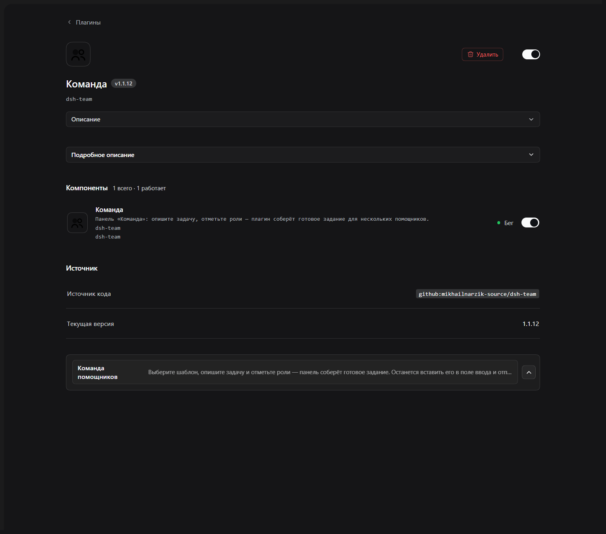

# dsh-team

Панель «Команда» для DeepSeek Harness: помогает за несколько секунд собрать
задание для нескольких помощников (субагентов) и скопировать готовый текст в
поле ввода.



*Страница плагина в интерфейсе DSH.*

## Что это и зачем

DSH умеет запускать помощников-субагентов, но задание для них каждый раз
приходится формулировать вручную: кому что делать, параллельно или по очереди,
что проверить в конце. Панель «Команда» делает это за вас:

- даёт **шаблон** под типовую работу (ревью, рефакторинг, исследование, тесты);
- подставляет **заготовку текста задачи**, которую остаётся уточнить;
- отмечает **роли** помощников (кто собирает факты, кто пишет код, кто
  проверяет);
- добавляет в задание **порядок запуска** — параллельно или по очереди;
- собирает всё в готовый текст и **копирует в буфер обмена**.

Термины простыми словами:

- **субагент** — помощник, которого агент запускает внутри своей работы; он
  получает отдельное задание и возвращает результат;
- **шаблон** — заранее заготовленная формулировка задачи с местом для
  подстановки (`<путь>`, `<что>`, `<тема>`);
- **роли** — строки в задании, объясняющие агенту, каких помощников запустить;
- **параллельно** — все помощники работают одновременно; **по очереди** —
  следующий получает результат предыдущего.

Важно: плагин **ничего не запускает сам**. Он только готовит текст задания.
Запускают помощников инструменты агента, потому что только агент видит контекст
беседы и решает, сколько помощников нужно.

## Как открыть

1. Нажмите **Настройки** (шестерёнка).
2. Перейдите в **«Плагины»**.
3. Найдите карточку **«Команда»** (иконка с двумя человечками) и откройте её.
4. В карточке видна свёрнутая строка «Команда помощников» с короткой подсказкой
   и кнопкой-шевроном справа. Нажмите **шеврон**, чтобы развернуть панель;
   повторное нажатие сворачивает её обратно.

Свёрнутое состояние выбрано специально: в общем списке плагинов панель не
должна занимать пол-экрана.

У плагина есть **собственная панель в левой панели**: если она закреплена,
нажмите **«Команда»** — откроется сборка задания целиком, без описания плагина,
источника и версии. Открепили панель? Она осталась в меню **«Ещё»** внизу левой
панели — там её можно закрепить обратно. Видимость и закрепление панелей
настраиваются в плагине **«Оформление интерфейса»**.

## Как пользоваться пошагово

Сценарий: попросить агента сделать ревью кода помощниками.

1. Откройте панель, как описано выше (шеврон в строке «Команда помощников»).
2. В списке **«Шаблон»** выберите **«Ревью кода»**.
   **Что произойдёт:** поле задачи заполнится заготовкой «Проведи ревью кода в
   `<путь>`: найди ошибки и риски, предложи конкретные правки», а роли
   «Исследователь» и «Проверяющий» отметятся сами.
3. Замените `<путь>` на свой, например `src/plugins/sync`.
4. Проверьте роли: при необходимости поставьте или снимите галочки
   «Исследователь», «Исполнитель», «Проверяющий». Переключатель «Запустить
   параллельно» уже выставлен шаблоном — можно поменять.
5. Посмотрите блок **«Готовое задание»**: там сразу виден итоговый текст. Он
   обновляется на каждое изменение.
6. Нажмите **«Скопировать»**. Появится подпись «Скопировано — вставьте в поле
   ввода», а само задание попадёт в «Последние задания».
7. Вернитесь в чат, вставьте текст в поле ввода (Ctrl+V) и отправьте.
   **Ожидаемый результат:** агент запускает помощников и присылает сводный
   ответ; при включённом dsh-notify о завершении сообщит плашка с бейджем
   «субагент».

Кнопка **«Очистить»** стирает текст задачи. **«Свернуть»** (шеврон) закрывает
панель.

## Примеры

Шаблоны и что они подставляют:

| Шаблон | Заготовка задачи | Роли | Порядок |
| --- | --- | --- | --- |
| Своя задача | пустое поле | Исследователь, Исполнитель | параллельно |
| Ревью кода | «Проведи ревью кода в `<путь>`: найди ошибки и риски, предложи конкретные правки» | Исследователь, Проверяющий | параллельно |
| Рефакторинг | «Отрефактори `<что>`: сохрани поведение, упрости структуру, прогони тесты» | все три | по очереди |
| Исследование | «Исследуй `<тему>`: собери факты из кода и документации, выдели ключевые выводы» | Исследователь | параллельно |
| Тесты | «Напиши тесты для `<что>`: покрой основные сценарии и крайние случаи» | Исполнитель, Проверяющий | по очереди |

Пример готового задания (как его увидите в блоке «Готовое задание»):

```
Команда помощников

Задача для команды: Проведи ревью кода в src/plugins/sync: найди ошибки и риски, предложи конкретные правки.

Роли:
- Исследователь — собирает факты и файлы
- Проверяющий — проверяет результат

Запусти помощников параллельно (subagent), затем сведи результаты в один ответ.
В конце укажи, что сделал каждый помощник и что удалось проверить.
```

Примеры задач, для которых панель особенно полезна:

- «Разбей работу на три части: один помощник ищет причину падения тестов,
  второй готовит исправление, третий проверяет» — выберите «Своя задача»,
  отметьте все три роли, порядок «по очереди».
- «Сравни два подхода к кэшированию» — «Исследование» + роль Исследователь.
- «Покрой новый модуль тестами» — «Тесты».

## Что вы увидите

Страница «Команды» оформлена в общем стиле плагинов DSH: по центру колонка
шириной до 960 px, сверху шапка с иконкой 👥, названием, подзаголовком,
кнопкой-статусом порядка запуска («Параллельно» или «По очереди») и кнопкой
«Обновить». Ниже — карточки-секции «Шаблон», «Роли», «Задача для команды»,
«Готовое задание» и «Последние задания»; на узком окне они выстраиваются в одну
колонку.

- **Шапка «Команда помощников»:** иконка, название, короткая подсказка,
  кнопка-статус порядка запуска (высота 32 px, радиус 10, рамка, мягкая
  заливка и точка-индикатор) и кнопка «Обновить».
- **«Шаблон»** — выпадающий список из пяти пунктов.
- **«Задача для команды»** — большое поле с подсказкой-примером внутри
  («Например: проверь плагин синхронизации и предложи три исправления»).
- **«Роли»** — три галочки: «Исследователь — собирает факты и файлы»,
  «Исполнитель — пишет код», «Проверяющий — проверяет результат», и отдельная
  галочка **«Запустить параллельно»**.
- **Кнопки** «Скопировать» (основная) и «Очистить», рядом — короткое
  сообщение: «Скопировано — вставьте в поле ввода» или «Сначала опишите
  задачу».
- **«Готовое задание»** — серый блок с итоговым текстом; пока поле задачи
  пустое, там написано «Опишите задачу выше, чтобы увидеть задание».
- **«Последние задания»** — до 5 последних скопированных задач списком
  строк-карточек: слева время (12 px, 600, secondary, колонка 44 px), справа
  текст в одну строку с многоточием и полной подсказкой при наведении; строки
  разделены тонкими линиями, при наведении подсвечиваются. Список не выше
  200 px и прокручивается внутри тонким скроллбаром; пока истории нет —
  пустое состояние с иконкой 🕘 и подсказкой «Скопированные задания появятся
  здесь». Клик по строке возвращает её в панель и ставит шаблон «Своя задача».

**Кнопки и адаптив.** Кнопки — одной системы: высота 36 px (в шапке 32), padding
0 14 px, радиус 10 px, ширина по тексту, строки переносятся. «Скопировать» —
мягкая заливка brand 18 % с brand-рамкой и brand-текстом (белой заливки с белым
текстом нет: в тёмной теме brand сам белый), «Очистить» и «Обновить» — secondary
с рамкой. Кнопка-статус порядка запуска — та же система: высота 32 px, радиус
10, рамка, мягкая заливка и точка (не пилюля). Сетка карточек `auto-fit` с
минимумом 280 px, карточки в ряду одной высоты, подсказка в карточке шаблона
прижата к низу; на 900 px остаётся одна колонка, на 640 px уменьшаются отступы,
на 480 px кнопки растягиваются на строку. Проверено на 1280, 1024, 768 и 480 px:
ничего не выходит за край, горизонтальной прокрутки страницы нет.

**Высота окна.** Страница — flex-колонка с `min-height:0` и нижним отступом
24 px: она не вылезает за пределы панели, а при нехватке высоты прокручивается
целиком, не сплющивая карточки. Список «Последние задания» ограничен 200 px и
прокручивается внутри тонким скроллбаром; поле задачи тянется вниз от 80 до
220 px (`resize:vertical`), блок «Готовое задание» — до 200 px. Проверено на
высоте окна 700 px: нижняя карточка и кнопки достижимы прокруткой, ничего не
обрезано.

## Частые ошибки и что делать

| Симптом | Причина | Что сделать |
| --- | --- | --- |
| Панель не находится | плагин не установлен или открыт не тот раздел | Настройки → Плагины → карточка «Команда»; установить плагин при необходимости |
| Нажимаю «Скопировать», появляется «Сначала опишите задачу» | поле задачи пустое | заполнить «Задача для команды» или выбрать шаблон |
| Текст скопировался, а в чате пусто | вставка не выполнена | поставить курсор в поле ввода и нажать Ctrl+V |
| Буфер обмена недоступен | браузер запретил доступ к буферу | текст всё равно виден в «Готовое задание» — выделите его мышью и скопируйте вручную |
| «Последние задания» пусты | ничего не копировали или данные браузера очищены | история появляется после первого копирования; хранится в браузере и не переносится между профилями |
| Агент не запустил помощников | плагин только готовит текст, а решает агент; он мог счесть задачу простой | уточните в сообщении: «запусти помощников через subagent», или выберите шаблон с ролями |
| После нажатия шеврона панель не открылась | карточка не догрузилась | обновить страницу Harness; если не помогло — перезапустить приложение |

## Ограничения и безопасность

- Плагин **не запускает** помощников и не вызывает инструменты: только готовит
  текст. Запуск остаётся за агентом, у которого есть контекст и права.
- Вся работа идёт в браузере; серверной части и сетевых запросов нет.
- «Последние задания» хранятся в `localStorage` браузера (ключ
  `dsh-team:history`, не больше 5 записей). После очистки данных браузера,
  смены профиля или другого устройства список будет пустым. Внутрь сессий
  DSH и в модель эти записи не попадают.
- Буфер обмена — системный: скопированное задание доступно другим программам,
  пока вы не скопируете что-то другое.
- Роли и порядок запуска — это **просьба** в тексте, а не жёсткая инструкция:
  агент может отступить от неё, если посчитает иначе.
- Плагин не проверяет, что задача вообще требует помощников: для простой
  задачи достаточно обычного сообщения.

## Связанные плагины

- **dsh-notify** — сообщает плашкой о завершении задачи и субагентов; удобно
  вместе с «Командой», чтобы не ждать у экрана.
- **dsh-review** — ревью изменений, тесты и создание PR; удачно дополняет
  шаблон «Ревью кода».
- **dsh-compact** — сжатие длинного диалога в короткую выжимку, если сессия с
  командой помощников разрослась.
- **dsh-polish** — единое оформление кнопок и полей у всех плагинов.

## Установка

Плагин ставится как обычный bundle DSH через менеджер плагинов
(**Настройки → Плагины**) — из репозитория или из локальной папки. Например,
для локальной копии:

```powershell
dsh plugin --profile desktop add "link:<путь к папке dsh-team>"
```

После установки или обновления кода перезапустите DeepSeek Harness. При
установке через `link:` файлы плагина лежат в отдельной папке, и пересборка
`node_modules` их не трогает.

Удаление: **Настройки → Плагины** → у карточки «Команда» кнопка удаления, или
`dsh plugin --profile desktop remove dsh-team`.
