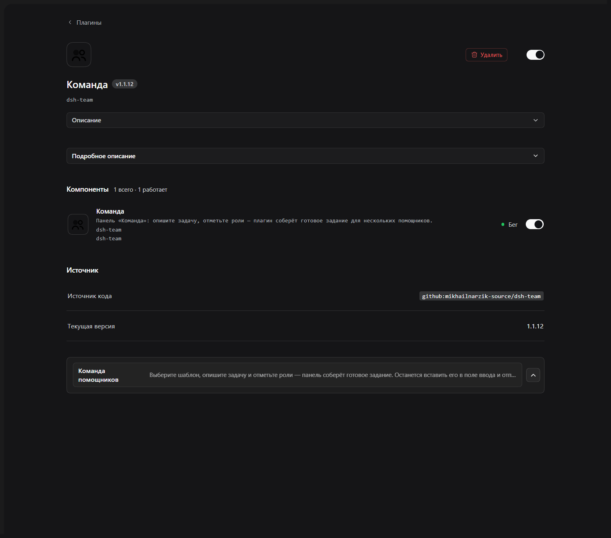
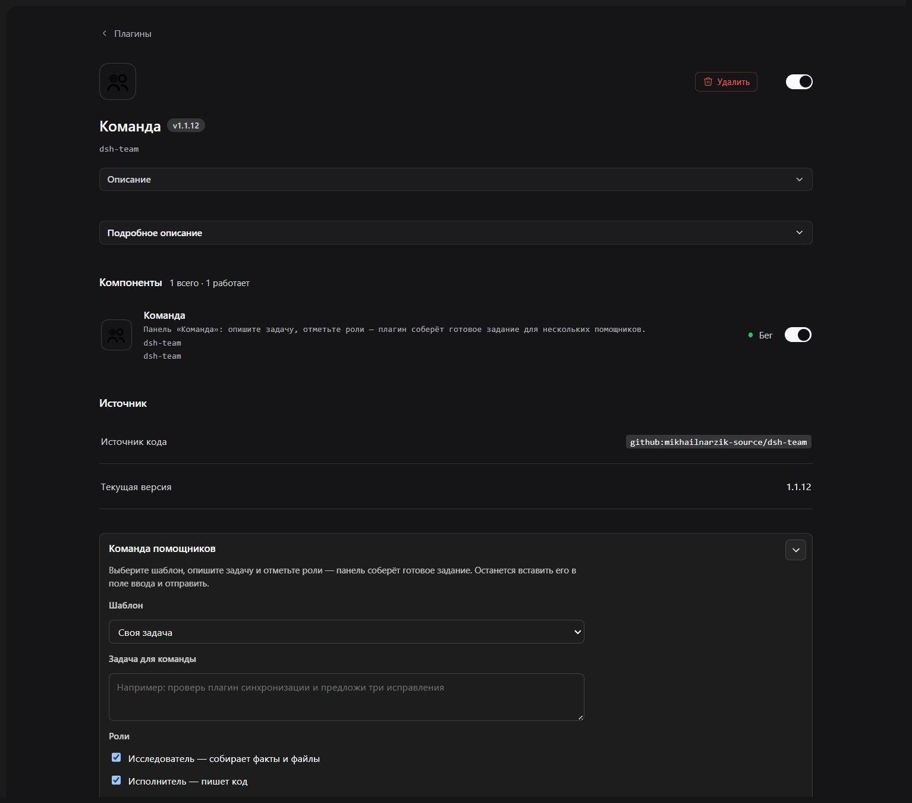

# Панель «Команда» — подробное описание

Плагин `dsh-team` добавляет в карточку плагина панель, которая собирает задание
для нескольких помощников (субагентов) и копирует его в буфер обмена. Этот файл
— подробная версия руководства: те же шаги, но с разбором всех элементов,
шаблонов и ограничений. Краткая версия — в `README.md` плагина.

## Что это и зачем

Помощники-субагенты в DSH запускаются инструментами агента (`subagent`,
`subagent_fork`, `workflow`). Чтобы они получили осмысленные задания, агенту
нужен текст с распределением работы. Составлять такой текст вручную каждый раз
долго и легко что-то забыть: роли, порядок запуска, что сделать в конце.

Панель «Команда» закрывает именно эту часть:

1. **Шаблон** подставляет заготовку под типовую работу.
2. **Поле задачи** уточняет формулировку.
3. **Роли** объясняют, каких помощников запускать.
4. **Переключатель параллельности** задаёт порядок.
5. **«Скопировать»** кладёт готовый текст в буфер обмена — остаётся вставить
   его в поле ввода и отправить.

Термины:

- **субагент** — помощник, которого агент запускает внутри своей задачи; у него
  своя сессия, своё задание и свой результат;
- **шаблон** — готовый текст с местом для подстановки: `<путь>`, `<что>`,
  `<тема>`;
- **сессия** — один диалог в DSH;
- **localStorage** — небольшое хранилище в браузере, где плагин держит список
  последних заданий.

Плагин **не запускает** помощников: у него нет ни контекста беседы, ни прав на
вызов инструментов. Он готовит задание, а решение остаётся за агентом.

## Как открыть

1. **Настройки** (шестерёнка в интерфейсе DSH).
2. Раздел **«Плагины»**.
3. Карточка **«Команда»** (иконка с двумя человечками) — откройте её.
4. В карточке лежит свёрнутая строка «Команда помощников» с подсказкой и
   кнопкой-шевроном. Шеврон разворачивает панель и сворачивает обратно.

Панель встроена в страницу своего плагина и выглядит как рамка с полями; никаких
отдельных окон и команд запуска не требуется.

## Как пользоваться пошагово

Сценарий: собрать задание на ревью кода командой из двух помощников.

1. Откройте панель (шеврон в строке «Команда помощников»).
2. **«Шаблон»** → **«Ревью кода»**.
   **Результат:** поле задачи заполняется текстом «Проведи ревью кода в
   `<путь>`: найди ошибки и риски, предложи конкретные правки», роли
   «Исследователь» и «Проверяющий» отмечаются, «Запустить параллельно» —
   включено.
3. Замените `<путь>` на нужный путь к коду.
4. Проверьте галочки ролей и порядок запуска.
5. Посмотрите **«Готовое задание»** — это ровно тот текст, который уйдёт
   агенту. Блок обновляется при каждом изменении.
6. Нажмите **«Скопировать»**.
   **Результат:** подпись «Скопировано — вставьте в поле ввода»; задание
   появилось в «Последние задания».
7. Вставьте текст в поле ввода чата (Ctrl+V) и отправьте.
   **Ожидаемый результат:** агент запускает помощников и присылает сводный
   ответ — что сделал каждый и что удалось проверить.

Если нужно вернуться к прежней формулировке, кликните её строку в «Последние
задания»: задача, роли и порядок восстановятся, шаблон переключится на «Своя
задача».

## Примеры

### Шаблоны

| Шаблон | Заготовка | Роли | Параллельно |
| --- | --- | --- | --- |
| Своя задача | пусто | Исследователь, Исполнитель | да |
| Ревью кода | «Проведи ревью кода в `<путь>`: найди ошибки и риски, предложи конкретные правки» | Исследователь, Проверяющий | да |
| Рефакторинг | «Отрефактори `<что>`: сохрани поведение, упрости структуру, прогони тесты» | Исследователь, Исполнитель, Проверяющий | нет |
| Исследование | «Исследуй `<тему>`: собери факты из кода и документации, выдели ключевые выводы» | Исследователь | да |
| Тесты | «Напиши тесты для `<что>`: покрой основные сценарии и крайние случаи» | Исполнитель, Проверяющий | нет |

### Готовый текст

```
Команда помощников

Задача для команды: <текст из поля>

Роли:
- Исследователь — собирает факты и файлы
- Исполнитель — пишет код
- Проверяющий — проверяет результат

Запусти помощников параллельно (subagent), затем сведи результаты в один ответ.
В конце укажи, что сделал каждый помощник и что удалось проверить.
```

При выключенном «Запустить параллельно» четвёртая строка меняется на: «Запускай
помощников по очереди, передавая результат следующему».

### Команды агенту и сценарии

- «Сделай ревью `src/plugins/sync` помощниками: один исследует, второй
  проверяет» → шаблон «Ревью кода».
- «Разбей рефакторинг на три шага: исследование, правка, проверка» → шаблон
  «Рефакторинг», роли все три, порядок «по очереди».
- «Собери факты про кэширование в проекте» → «Исследование».
- «Покрой тестами новый модуль» → «Тесты».

## Что вы увидите

- **Шапка страницы:** иконка, название «Команда помощников», подсказка, чип
  «Параллельно» или «По очереди» и кнопка «Обновить».
- **«Шаблон»:** выпадающий список из пяти пунктов; выбор сразу меняет поле
  задачи и галочки.
- **«Задача для команды»:** многострочное поле с подсказкой-примером.
- **«Роли»:** три галочки с пояснениями и отдельная галочка «Запустить
  параллельно».
- **Кнопки:** «Скопировать» (синяя, основная) и «Очистить»; справа от них —
  короткое сообщение о результате.
- **«Готовое задание»:** рамка с окончательным текстом. Пока задача не описана
  — «Опишите задачу выше, чтобы увидеть задание».
- **«Последние задания»:** до пяти строк «время — текст». Клик по строке
  восстанавливает задание. Пустое состояние: «Скопированные задания появятся
  здесь».


## Как это выглядит



*Рисунок 1. Страница плагина: описание, настройки и кнопки.*



*Рисунок 2. Рабочий раздел плагина: органы управления и результат.*

Страница собрана по общему каркасу плагинов DSH: центрированный контейнер
шириной до 960 px с отступами 24/28/40, шапка с иконкой 52 × 52 (👥), названием,
подзаголовком, чипом порядка запуска и кнопкой «Обновить», ниже — карточки-секции
с акцентной полоской у заголовка. «Шаблон» и «Роли» стоят в сетке
`repeat(auto-fit, minmax(280px, 1fr))`: на широком экране рядом, на узком (до
760 px) — друг под другом, с уменьшенными отступами 18/16/32. Цвета — токены
DSH, поэтому страница сама подстраивается под светлую и тёмную тему.

## Частые ошибки и что делать

| Симптом | Причина | Что сделать |
| --- | --- | --- |
| Панель не открывается | плагин не установлен, открыт не тот раздел, страница недогрузилась | Настройки → Плагины → «Команда»; обновить страницу; перезапустить Harness |
| «Сначала опишите задачу» | поле задачи пустое | заполнить поле или выбрать шаблон |
| После копирования в чате ничего нет | текст не вставлен | вставить Ctrl+V в поле ввода |
| Буфер обмена не сработал | браузер запретил доступ | скопировать текст вручную из «Готовое задание» — оно никуда не делось |
| Задание потерялось | «Последние задания» — только копирования последних пяти, хранятся в браузере | восстановить из строки истории, пока она есть; на другом устройстве/профиле история своя |
| Агент не запустил помощников | плагин только готовит текст; агент может решить, что задача простая | прямо попросить «запусти помощников через subagent» и отправить задание заново |
| Роли проигнорированы | роли — просьба в тексте, а не жёсткая команда | усилить формулировку в поле задачи |
| Панель занимает пол-экрана | она развёрнута | нажать шеврон «Свернуть» |

## Ограничения и безопасность

- **Нет запуска.** Плагин не вызывает `subagent`/`workflow` и не может этого
  делать: запуск решает агент в беседе.
- **Нет серверной части.** `index.js` плагина пустой: сборка текста и буфер
  обмена работают в браузере, сетевых запросов плагин не делает.
- **История** — `localStorage`, ключ `dsh-team:history`, максимум 5 записей.
  Данные не синхронизируются между устройствами и пропадают при очистке данных
  браузера. В модель и в журналы сессий DSH история не попадает.
- **Буфер обмена** системный: скопированный текст виден другим программам.
- **Роли и порядок** остаются рекомендацией: агент видит текст как обычное
  сообщение пользователя.
- **Проверка:** `node test/smoke.mjs` — регистрация карточки, словари обоих
  языков, сборка задания с ролями и без, порядок «параллельно» и «по очереди».

## Связанные плагины

- **dsh-notify** — плашки о завершении задачи и каждого субагента; вместе с
  «Командой» не нужно ждать у экрана.
- **dsh-review** — ревью изменений, тесты, коммит/push и PR; сочетается с
  шаблоном «Ревью кода».
- **dsh-compact** — короткая выжимка длинного диалога без нейросети.
- **dsh-polish** — единый вид кнопок и полей во всех темах.

## Как это устроено

| Файл | Что делает |
| --- | --- |
| `index.js` | host-часть: намеренно пустая, серверных задач нет |
| `client.js` | браузерная половина: панель, шаблоны, сборка текста, история |
| `locale/ru.json`, `locale/en.json` | название и описание плагина в списке «Плагины» |
| `cordis.patch.yml` | вставка плагина в профиль |
| `test/smoke.mjs` | проверка сборки задания и словарей |

Текст собирается функцией `buildRequest`: заголовок → задача → роли → порядок
запуска → завершающая просьба свести результаты. Кнопка «Скопировать» пишет
текст в буфер и добавляет запись в историю; при недоступном буфере текст всё
равно остаётся в предпросмотре.
